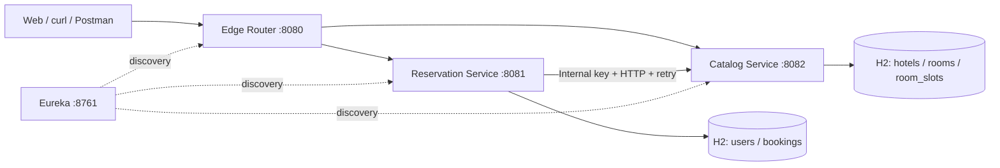

# Сервисное API управления гостиницами

Backend проект для бронирования номеров. Проект написан на **Java 17 / Spring Boot 3.5**, использует
**Spring Cloud Gateway, Eureka, JPA, H2, Spring Security, JWT, Spring Retry, Resilience4j**.

## Что умеет

- Регистрация, вход, выдача JWT на 60 минут; полномочия `USER` и `ADMIN`.
- Просмотр гостиниц, фильтрация свободных комнат по интервалу `[startDate, endDate)`.
- Рекомендации: по `timesBooked` по возрастанию, затем по `roomId`. При выборе автоматически
  проверяется следующая комната, если предыдущую успел занять другой поток.
- Создание брони через локальный `PENDING` → подтверждение слота в каталоге → `CONFIRMED`.
  В случае конфликта/неудачи — `CANCELLED` и освобождение слота при необходимости.
- Идемпотентные запросы с UUID `requestId`, защита от двойного бронирования через
  `PESSIMISTIC_WRITE` на строке комнаты и уникальный `bookingId` в журнале слотов.
- Отложенный повтор компенсации после отказа сервиса каталога, HTTP-тайм-ауты,
  экспоненциальная задержка между тремя попытками и Circuit Breaker.
- Просмотр только своих броней, отмена, администрирование гостиниц, комнат и аккаунтов,
  статистика по отелям, пагинация истории.

## Как система связана



**Маршруты:** шлюз передаёт `/api/auth/**`, `/api/bookings/**`, `/api/admin/users/**`
в `reservations`, а `/api/hotels/**` и `/api/rooms/**` — в `catalog`. Перенаправление
через `lb://` обращается к Eureka. Заголовок `Authorization` передаётся без модификации;
каждый backend проверяет подпись и срок JWT независимо от шлюза. `X-Internal-Key` при
входе в Gateway всегда удаляется; `/internal/**` не маршрутизируется публично.

## Дерево проекта

```text
staypilot-platform/
├── contracts/        # DTO между сервисами, JWT и единый API error, correlation filter
├── registry/         # Eureka Server
├── edge/             # API Gateway, маршрутные правила, предварительная проверка ролей
├── catalog/          # отели, комнаты, занятые интервалы, статистика
├── reservations/     # пользователи, JWT-выдача, сага, REST-клиент, восстановление
├── docs/decisions/   # архитектурные решения (ADR)
├── http/             # примеры REST-запросов
├── Dockerfile
└── compose.yaml
```

В каждом бизнес-модуле есть `model`, `persistence`, `application`, `api`, `config`.
Транзакции JPA используются только для изменений своей H2-базы. Прямых таблиц/Entity
другого сервиса в локальной базе нет. `contracts` — библиотека, не отдельное приложение.

## Быстрый старт

установлен Docker с Docker Compose. Из корня:

```bash
cp .env.example .env   # необязательно, но лучше задать отдельные значения ключей
# В файле .env задайте свои JWT_SECRET и SERVICE_SHARED_KEY
docker compose up --build -d
docker compose logs -f edge reservations catalog
```

| Компонент | Адрес |
|---|---|
| Gateway | http://localhost:8080 |
| Reservation Swagger | http://localhost:8081/swagger-ui/index.html |
| Catalog Swagger | http://localhost:8082/swagger-ui/index.html |
| Eureka UI | http://localhost:8761 |
| Проверка здоровья | `http://localhost:8081/actuator/health`, аналогично на `8082` |

Остановка: `docker compose down`. Хранилища H2 **in-memory**: после перезапуска все
изменения исчезнут и начальные данные будут восстановлены.

### Данные для демонстрации

| Роль | Логин | Пароль |
|---|---|---|
| USER | `traveler` | `Traveler123!` |
| ADMIN | `operator` | `Operator123!` |

В каталоге создаются 3 гостиницы и 6 комнат. У них разные счётчики прошлых броней
(`0, 1, 2, 5`) для демонстрации сортировки; прошлые брони — **условная статистика**,
без вымышленных активных слотов. Пароли хранятся в BCrypt, а не в открытом виде.
**Это демонстрационные данные, их нельзя использовать в публичном окружении.**

## Пример сценария

1. Получить токен от `POST /api/auth/login` с JSON `{"username":"traveler","password":"Traveler123!"}`.
2. Передавать `Authorization: Bearer <token>` в запросах к Gateway (`:8080`).
3. Узнать свободные комнаты `GET /api/rooms/recommend?startDate=2027-04-12&endDate=2027-04-15`.
4. Создать бронь через `POST /api/bookings`:

```json
{
  "requestId": "c9b7b2f4-4f1a-4249-9e19-8b203c242df4",
  "autoSelect": true,
  "startDate": "2027-04-12",
  "endDate": "2027-04-15"
}
```

При ручном подборе: `"autoSelect":false, "roomId":2` (номер нужно предварительно
получить из `/api/rooms`). Для каждого *нового* бронирования используйте новый UUID
`requestId`. Повтор с тем же UUID и теми же параметрами возвращает существующую бронь;
повтор с другим содержимым — `409`. Если второй запрос пришёл до завершения первого,
возможен `202 PENDING`: состояние опрашивается через `GET /api/bookings/{id}`.
У статуса `CANCELLED` может быть `compensationPending=true` (восстановление запланировано).

## REST API

Все публичные маршруты доступны через `localhost:8080`; `/internal/*` только при
прямом взаимодействии двух сервисов с отдельным `SERVICE_SHARED_KEY`.

| HTTP | Маршрут | Права | Назначение |
|---|---|---|---|
| POST | `/api/auth/register` | без JWT | создать USER + токен |
| POST | `/api/auth/login` | без JWT | получить токен |
| POST | `/api/bookings` | USER/ADMIN | забронировать, выбор вручную или автоматически |
| GET | `/api/bookings?page=0&size=20` | USER/ADMIN | история текущего пользователя |
| GET | `/api/bookings/{id}` | владелец/ADMIN | детали брони |
| DELETE | `/api/bookings/{id}` | владелец/ADMIN | отмена + освобождение слота |
| GET | `/api/hotels` | JWT | список гостиниц |
| GET | `/api/hotels/{id}` | JWT | гостиница |
| POST | `/api/hotels` | ADMIN | добавить гостиницу |
| PATCH | `/api/hotels/{id}` | ADMIN | частично обновить |
| DELETE | `/api/hotels/{id}` | ADMIN | удалить, только когда нет комнат |
| GET | `/api/hotels/{id}/statistics` | ADMIN | комнаты, доступность, накопленные/активные брони |
| GET | `/api/rooms?startDate=...&endDate=...` | JWT | свободные на даты |
| GET | `/api/rooms/recommend?startDate=...&endDate=...` | JWT | по количеству броней, затем ID |
| GET | `/api/rooms/{id}` | JWT | номер |
| POST | `/api/rooms` | ADMIN | создать номер |
| PATCH | `/api/rooms/{id}` | ADMIN | изменить параметры/доступность |
| DELETE | `/api/rooms/{id}` | ADMIN | удалить только без истории/слотов |
| GET | `/api/admin/users` | ADMIN | пользователи |
| POST | `/api/admin/users` | ADMIN | создать USER/ADMIN |
| PATCH | `/api/admin/users/{id}` | ADMIN | пароль/роль |
| DELETE | `/api/admin/users/{id}` | ADMIN | удалить без истории бронирований |

`startDate` входит в диапазон, `endDate` не входит — последовательные проживания
без пересечения могут начинаться и заканчиваться в один день. `available` означает
техническую пригодность номера (например, ремонт), а не его занятость по датам.

**Внутренние операции** `GET /internal/rooms/recommend`, `POST /internal/rooms/{id}/hold`,
`POST /internal/rooms/{id}/release` доступны только Reservation Service. Контракт JSON
описан в [`contracts/README.md`](contracts/README.md).

## Надёжность и наблюдаемость

- Слот вставляется только после блокировки строки номера (`PESSIMISTIC_WRITE`) и проверки
  отсутствия пересечений. Контроль уникальности `bookingId` в `room_slots` делает
  `hold/release` идемпотентными. Отмена до позднего ответа записывает RELEASED tombstone.
- В Booking Service `requestId` уникален и хранится вместе с отпечатком полей. Повторная
  доставка не создаёт дубликат. Бронирование вначале коммитится в `PENDING` отдельно.
- У HTTP-клиента соединение до 800 мс, ожидание ответа до 1500 мс; 3 попытки с задержкой
  150 → 300 мс. Конфликт 409 не повторяется. Circuit Breaker ограничивает массовые сбои.
- После неудачи брони записывается `CANCELLED` и флаг `compensationPending`. При неудаче
  `release` повторяет фоновый планировщик раз в 15 сек (пока процесс жив).
  Локальные H2 базы не переживают рестарт, поэтому для production нужен persistent storage.
- В логах `correlationId` и `bookingId`, события `booking_pending`, `hold_created`,
  `booking_confirmed`, `booking_cancelled`, `compensation_completed/queued`.
- Формат ошибки: `timestamp`, `status`, `code`, `message`, `path`, `correlationId`;
  типичные статусы: `400` неверные данные, `401` нет токена, `403` недостаточно прав,
  `404` не найдено, `409` конфликт, `503` недоступна проверка номера.

## Тестирование

```bash
mvn clean verify
mvn -pl catalog -am test
mvn -pl reservations -am test
mvn -pl edge -am test
```

Тесты (`JUnit 5`, `MockMvc`, `WebTestClient`, `Mockito`, реальная H2) проверяют:
гонку двух потоков за один номер, повторный hold/release, tombstone, сортировку,
JWT/доступы, успешную сагу, тайм-аут и компенсацию, идемпотентность, выбор
другого номера при конфликте, валидацию дат.
Сквозной ручной сценарий для Postman/IDE — [`http/demo.http`](http/demo.http).

Архитектурные решения: [ADR-001 о саге](docs/decisions/001-reservation-saga.md),
[ADR-002 о безопасности](docs/decisions/002-trust-boundaries.md).
